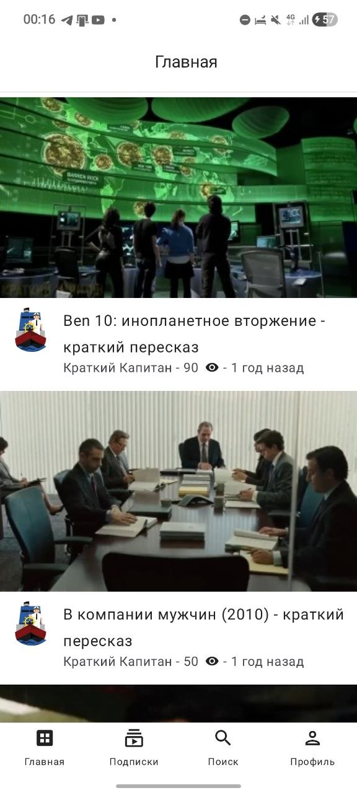
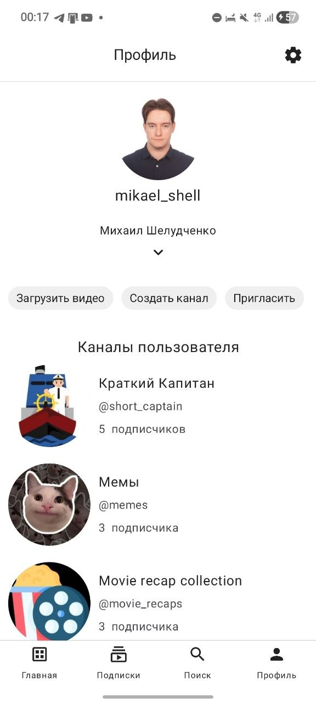
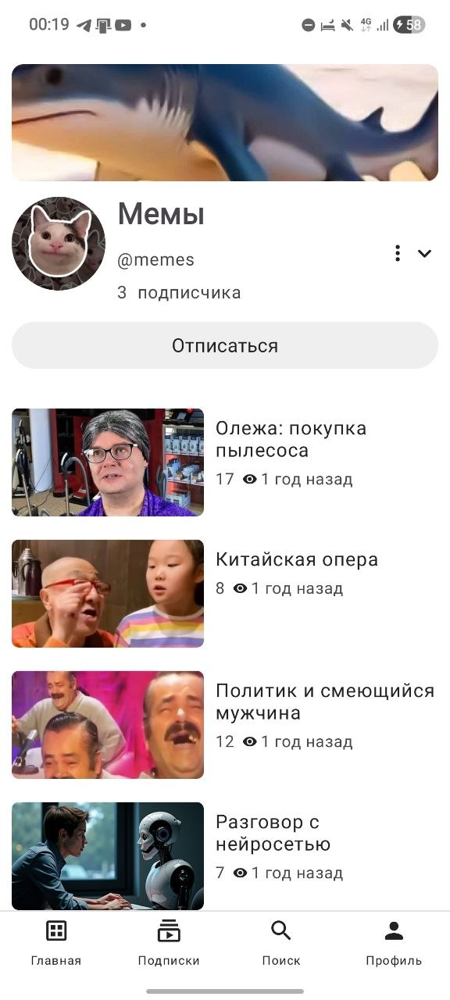
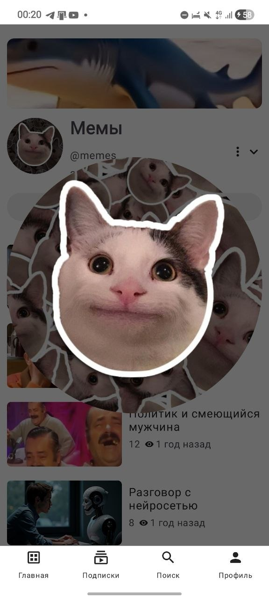
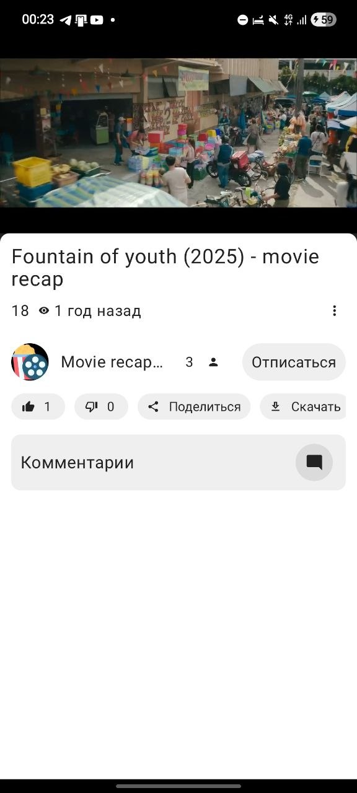
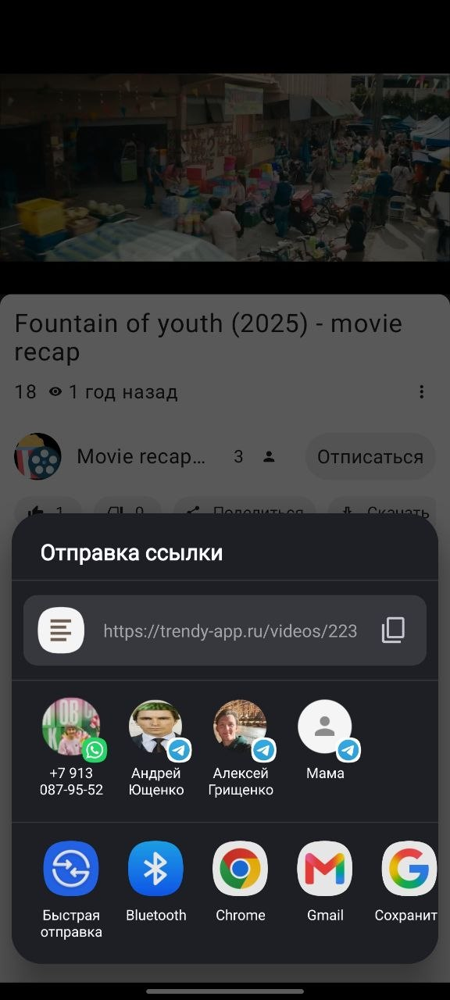
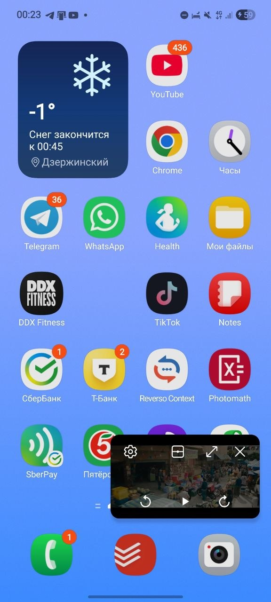
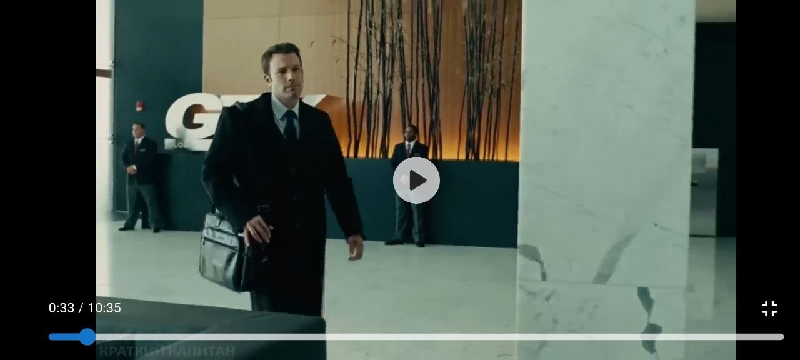

<h1>Trendy</h1>

## Что это?

**Trendy** - это видео-хостинг. Другими словами, площадка для просмотра и публикации видео.

## Что можно делать?

- Зарегистрироваться/войти с email и паролем, а также восстановить пароль
- Редактировать профиль
- Создать/редактировать/удалить канал
- Иметь несколько каналов в одном аккаунте
- Искать видео
- Опубликовать/редактировать/удалить видео
- Быстро перематывать видео двойным нажатием в левую/правую часть экрана
- Оценить видео лайком/дизлайком
- Поделиться ссылкой на видео
- Оставлять/редактировать/удалять комментарии
- Продолжать смотреть видео в уменьшенном окне внутри приложения и при выходе из него
- Менять тему на тёмную/светлую/системную
- Устанавливать русский/английский язык

## Где скачать?

В Google Play опубликовано **Trendy 3.0.0**

## Технические характеристики

Используется следующий стек технологий:

Приложение разработано по принципам разделения уровней `Clean Architecture`. Архитектура - `Model-View-Intent` (`MVI`).

`Jetpack Compose` использован для реализации экранов и UI-кита: 
- поля ввода текста и выбора файлов
- адаптированные `LazyGrid` с ленивой загрузкой
- `RestartableBox` - кастомный контейнер с возможностью перезагрузки без необходимости в том, чтобы контент был прокручивающимся (scrollable)
- типовые компоненты на подобие индикатора загрузки и ошибки

Адаптировано под экраны разного размера.

`ExoPlayer` - для создания видео-плеера.

`Navigation 3` - для создания вложенной системы навигации.

Компоненты `Android SDK`:

- Сервисы для загрузки на сервер и с него на телефон
- `BroadcastReceiver` для управления воспроизведением видео кнопками наушников и кнопками в режиме Picture-in-picture (уменьшенный плеер за пределом приложения)
- `Content Provider` для получения данных о выбираемых файлах

Системный сервис `AudioManager` для автоматической паузы/воспроизведения видео при входящем/исходящем звонке, сработавшем будильнике или при переключении в другие приложения с медиа

`Dagger Hilt` задействован для Dependency Injection.

`Retrofit` - для взаимодействия с сервером по HTTP 2.0 с TLS.

`Firebase Cloud Messaging` - для получения push-уведомлений о новых видео или об успешной загрузке видео на сервер.

Активно используются корутины и `Flow` для распаралеливания задач. 

Хранит ID пользователя и его токен в зашифрованном виде в `DataStore`.

`Firebase Analytics & Crashlytics` для сбора аналитики и информации об исключениях (ошибках)

## Контакты

Вы можете связаться со мной для переговоров о сотрудничестве, написав на email: contact@trendy-app.ru

## Лицензия и политика конфиденциальности

© 2026 Михаил Николаевич Шелудченко. Все права защищены.

Исходный код открыт только для ознакомления. Копирование, изменение, распространение
и использование кода или его частей без письменного разрешения автора запрещены.

Вы можете ознакомиться с политикой конфиденциальности по [ссылке](https://trendy-app.ru/docs/privacy-policy).